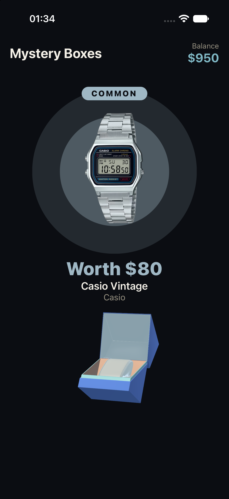
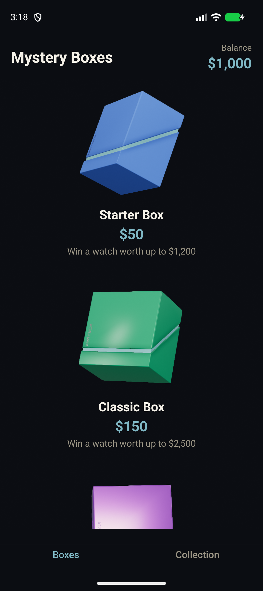
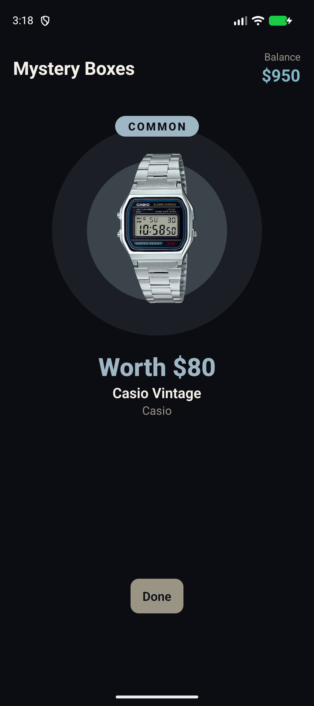
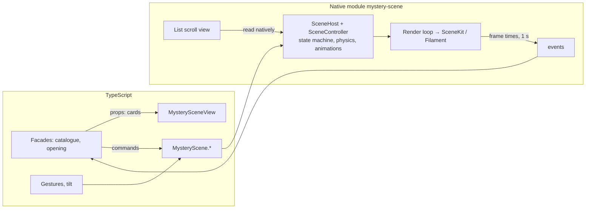

# `Mystery Watch Native` - React Native proof of concept with a pure native 3D scene

> **Documentation map:** [docs/README.md](docs/README.md) · **native scene:** [docs/NATIVE_SCENE.md](docs/NATIVE_SCENE.md) · **how to test:** [docs/TESTING.md](docs/TESTING.md) · **animations + screenshots:** [docs/ANIMATIONS.md](docs/ANIMATIONS.md) · **test results:** [docs/TEST_CHECKLIST.md](docs/TEST_CHECKLIST.md) · **FPS:** [docs/PERFORMANCE.md](docs/PERFORMANCE.md)
>
> **One rule above all:** test on **one platform at a time** (iOS Simulator *or* Android Emulator, the other shut down), see [docs/TESTING.md](docs/TESTING.md#rule-1--one-platform-at-a-time).

A scrollable catalogue of real-time 3D mystery boxes, inspect, buy with a virtual balance through an async mock API, animated lid and rarity reveal, collection. The big difference from a usual React Native 3D app: **the 3D is a purely native module**, written in **Swift (SceneKit) for iOS** and **Kotlin (Filament) for Android**. There is **no JavaScript 3D library**. The native code loads the model, owns the frame loop and does all 3D work; TypeScript keeps everything else.

   

## Contents

1. [What works, what does not](#1-what-works-what-does-not)
2. [Quick start](#2-quick-start)
3. [Architecture](#3-architecture)
4. [The native module `mystery-scene`](#4-the-native-module-mystery-scene)
5. [Quality gates and tests](#5-quality-gates-and-tests)
6. [Performance](#6-performance)
7. [Project structure](#7-project-structure)
8. [Known limits and decisions](#8-known-limits-and-decisions)
9. [Troubleshooting](#9-troubleshooting)

## 1. What works, what does not

Verified on **release builds**, iOS Simulator (iPhone 17, iOS 27) and Android Emulator (MW_Pixel9_API_37), one at a time:

- ✅ browse → inspect → buy → open (anticipation, lid, light) → reveal → box put away → Done → collection → detail sheet (screenshots in [docs/ANIMATIONS.md](docs/ANIMATIONS.md))
- ✅ exactly-once purchase (unit tests; on a device: one purchase = one deduction, seen on both platforms)
- ✅ `yarn ciPipeline` clean, `yarn test` green, Swift (XCTest) and Kotlin (JUnit) parity tests green
- ✅ catalogue scroll FPS: iOS 60.0 (0 slow frames after the first window), Android 60.0 after the first 3 windows (see [PERFORMANCE.md](docs/PERFORMANCE.md))
- ✅ Android boxes are on screen with the list (first frame 33-38 ms after the data; Filament runs on Vulkan, the OpenGL backend needed 10-14 s to compile shaders on the emulator, see [PERFORMANCE.md 2b](docs/PERFORMANCE.md))
- ⚠️ **Not verified / gaps:** Android pinch (adb cannot send two fingers), device tilt, physical devices. Verified on a device: iOS press squeeze (0.92), iOS `networkError` / `responseLost`. Details: [docs/TEST_CHECKLIST.md](docs/TEST_CHECKLIST.md).

## 2. Quick start

Prerequisites: macOS with Xcode 27, Android Studio + JDK 17 + the `MW_Pixel9_API_37` AVD, Node 24+, yarn classic, CocoaPods, `export LANG=en_US.UTF-8`.

```bash
yarn install
yarn iosPrebuild        # generates ios/ and autolinks modules/mystery-scene
yarn androidPrebuild    # generates android/ (application id com.gorrr.mysterywatch.native)
yarn ciPipeline && yarn test
```

### Just try it (release builds, no Metro)

```bash
# iOS (simulator booted)
cd ios && xcodebuild -workspace MysteryWatchNative.xcworkspace -scheme MysteryWatchNative -configuration Release \
  -sdk iphonesimulator -destination 'platform=iOS Simulator,name=iPhone 17' ONLY_ACTIVE_ARCH=YES -derivedDataPath /tmp/mw-dd build
xcrun simctl install booted /tmp/mw-dd/Build/Products/Release-iphonesimulator/MysteryWatchNative.app
xcrun simctl launch booted com.gorrr.mysterywatch.native

# Android (emulator running)
cd android && ./gradlew :app:assembleRelease && adb install -r app/build/outputs/apk/release/app-release.apk
adb shell am start -n com.gorrr.mysterywatch.native/com.gorrr.mysterywatch.nativeapp.MainActivity
```

The app is called **Mystery Watch Native** and uses the id `com.gorrr.mysterywatch.native`, so it never overwrites the other versions. (On Android the code package is `com.gorrr.mysterywatch.nativeapp` because `native` is a Java keyword; `plugins/withAndroidApplicationId.js` sets the real application id.)

What to expect: scroll the list, tap a box, drag it, buy it, tap *Open the box*, watch the reveal, then look at *Collection*. Start balance $1,000; a restart is a new session.

## 3. Architecture

TypeScript (flows, facades, adapters, Zustand, React Query, mock API, overlays, sounds, haptics) follows the conventions in [CLAUDE.md](CLAUDE.md). The 3D lives in the native module.



- **Per frame JavaScript sends nothing.** Scroll is read natively (KVO / scroll listener); fingers send small commands; every animation is a function of "now" inside the native state machine.
- **Render on demand:** the loop stops after three idle frames and wakes on any command or scroll.
- Full description, API, engine choice and trade-offs: [docs/NATIVE_SCENE.md](docs/NATIVE_SCENE.md).

## 4. The native module `mystery-scene`

`modules/mystery-scene` (autolinked). Typed API in `modules/mystery-scene/src`: a `MysterySceneView` (props `cards`, `scrollViewTag`, `isFrameStatsEnabled`, events) and synchronous commands `MysteryScene.setScrollOffset / pressIn / pressOut / focus / closeBox / openLid / setGlowColor / tuck / dragBy / dragEnd / pinch / resetView / setTilt`.

- **iOS:** SceneKit; `GlbLoader.swift` reads the GLB (SceneKit cannot).
- **Android:** Filament + gltfio directly.
- **Scene core** (`ios/SceneCore`, `android/.../math`): the same maths and state machine in Swift and Kotlin, proven against the TypeScript reference by shared test vectors (`modules/mystery-scene/test-vectors/sceneVectors.json`, generated by `src/services/sceneReference`).

## 5. Quality gates and tests

```bash
yarn ciPipeline                                             # ESLint + TypeScript
yarn test                                                   # Jest (233 tests, includes the vector generator check)
cd modules/mystery-scene/ios/SceneCore && swift test        # XCTest, 5 tests, runs on the Mac
cd android && ./gradlew :mystery-scene:testDebugUnitTest    # JUnit, 5 tests
```

Results are in [docs/TEST_CHECKLIST.md](docs/TEST_CHECKLIST.md); how to test by hand and measure FPS: [docs/TESTING.md](docs/TESTING.md).

## 6. Performance

Measured on release builds with the in-app meter (native frame times), list scrolling by itself for ~70 s: **iOS 60.0 FPS (4,591 frames, 1 slow frame in the first window), Android 60.0 FPS (4,174 frames, 0 slow frames, worst frame 17 ms)**; the emulator window also holds 60 FPS. Details, startup timeline and honest limits: [docs/PERFORMANCE.md](docs/PERFORMANCE.md).

## 7. Project structure

```
modules/mystery-scene/        the native module (see docs/NATIVE_SCENE.md for the tree)
plugins/                      Expo config plugin: Android application id
src/                          flows (catalogueFlow, openingFlow, collectionFlow), components, services, networking, models
src/services/sceneReference/  TypeScript reference of the scene maths + the test vector generator
scripts/app, scripts/perf     restart/tap helpers, FPS sink and analysis
scripts/native                native test runner
docs/                         documentation, media (screenshots), data (raw FPS logs)
```

## 8. Known limits and decisions

- The iOS look differs from Android in small ways (two engines); every known difference is in [docs/ANIMATIONS.md](docs/ANIMATIONS.md#platform-differences).
- The mock API takes 700 ms: the list shows "Loading boxes…" for that long; the native scene is created and its model parsed in the first ~20 ms (iOS), so on iOS boxes start popping in within about 5 ms of the data arriving, then the entrance plays (520 ms + 90 ms per card). On Android the first boxes are drawn with the list too (Vulkan backend).
- SceneKit is in maintenance at Apple; chosen for robustness and zero extra code for PBR/shadows/SSAO/bloom (see NATIVE_SCENE.md).
- `ios/` and `android/` are generated and git-ignored; `modules/mystery-scene/ios/Assets/box.glb` is a second copy of `assets/box.glb` (CocoaPods cannot read outside the pod folder).

## 9. Troubleshooting

| Symptom | Cause / fix |
|---|---|
| iOS: list shows, no boxes | `box.glb` missing from `MysteryScene.bundle` (copy it into `modules/mystery-scene/ios/Assets/`, `pod install`) |
| Android: list but no boxes for 10+ s | OpenGL backend shader compile on the emulator; the scene uses Vulkan (`FilamentBoxScene.kt`) |
| Android build: `Namespace ... 'native' is not a valid Java package` | use `android.package` `...nativeapp` and the plugin for the application id (already configured) |
| Android: old JavaScript after a rebuild | delete `android/app/build/generated/assets` and `android/app/build/intermediates/assets`, rebuild |
| Overlay / auto-scroll missing in a measurement build | the env vars are baked at bundle time; rebuild after deleting the bundle caches |
| Both platforms laggy | only one simulator/emulator at a time |
