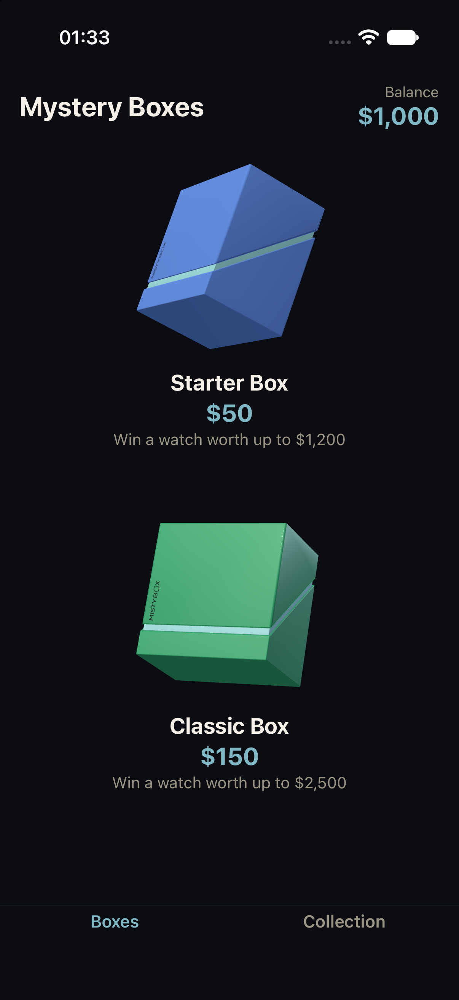
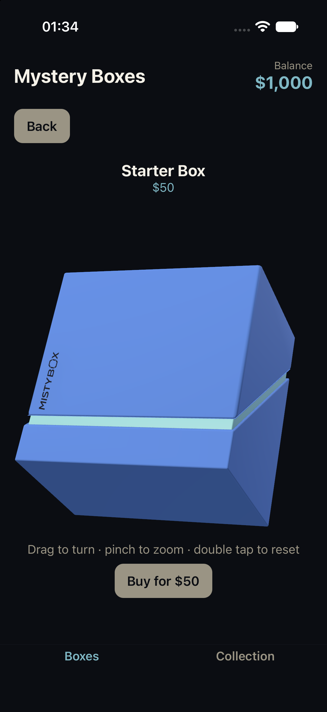
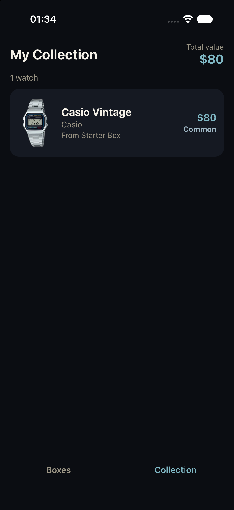
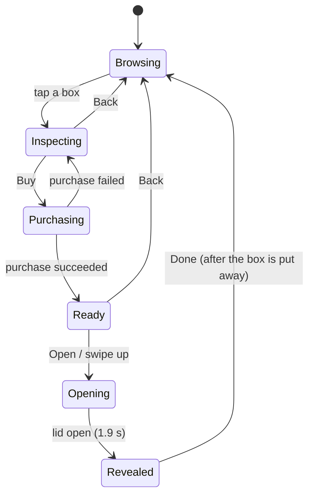
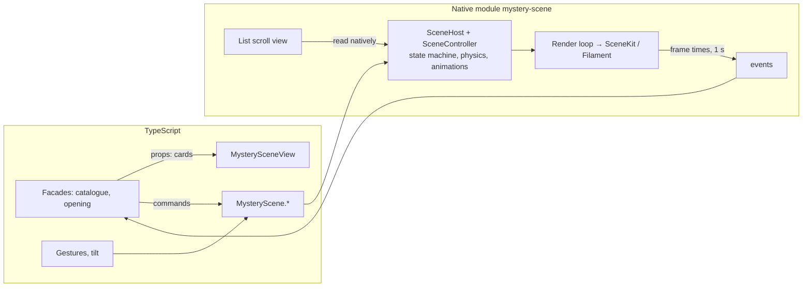
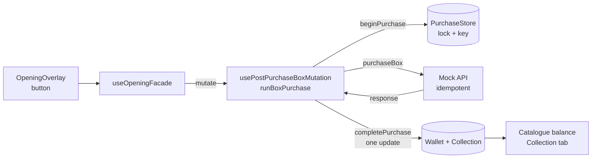

# `Mystery Watch Native` - React Native Proof of Concept

[](https://expo.dev/)
[](https://reactnative.dev/)
[](https://www.typescriptlang.org/)
[-f05138?logo=swift&logoColor=white)](https://developer.apple.com/documentation/scenekit)
[-ea4335?logo=kotlin&logoColor=white)](https://google.github.io/filament/)
[](https://docs.swmansion.com/react-native-reanimated/)
[](https://zustand-demo.pmnd.rs/)
[](https://tanstack.com/query/latest)

> **Documentation map:** [docs/README.md](docs/README.md) · **native scene:** [docs/NATIVE_SCENE.md](docs/NATIVE_SCENE.md) · **how to test:** [docs/TESTING.md](docs/TESTING.md) · **animations:** [docs/ANIMATIONS.md](docs/ANIMATIONS.md) · **the show:** [docs/EFFECTS.md](docs/EFFECTS.md) · **test results:** [docs/TEST_CHECKLIST.md](docs/TEST_CHECKLIST.md) · **FPS:** [docs/PERFORMANCE.md](docs/PERFORMANCE.md)
>
> **One rule above all:** test on **one platform at a time**. Either the Android emulator with the iOS simulator shut down, or the iOS simulator with the Android emulator shut down. They share the Mac's GPU and CPU; with both open you get false jank and useless FPS numbers ([why and how to switch](docs/TESTING.md#rule-1--one-platform-at-a-time)).

## Table of Contents

1. [Introduction](#1-introduction)
2. [Quick Start](#2-quick-start)
3. [The App](#3-the-app)
4. [Project Architecture](#4-project-architecture)
5. [Real-time 3D](#5-real-time-3d)
6. [The Native Module](#6-the-native-module)
7. [Quality Gates and Tests](#7-quality-gates-and-tests)
8. [Performance](#8-performance)
9. [Project Structure](#9-project-structure)
10. [Known Limits and Decisions](#10-known-limits-and-decisions)
11. [Troubleshooting](#11-troubleshooting)

---

## 1. Introduction

**Project Overview:**
Mystery Watch Native is a proof of concept for discovering, buying and opening mystery boxes that contain watches. A scrollable catalogue shows **real-time rendered 3D boxes**, you tap one to **inspect it with your finger and open it** with an animated lid and a reveal, a virtual balance pays for it, and the watches you win go into your collection. The assignment is in [docs/ASSIGNMENT.md](docs/ASSIGNMENT.md).

The big difference from a usual React Native 3D app: **the 3D is a purely native module**, written in **Swift (SceneKit) for iOS** and **Kotlin (Filament) for Android**. There is **no JavaScript 3D library**. The native code loads the model, owns the frame loop and does all 3D work; TypeScript keeps everything else.

The TypeScript side follows the conventions of an enterprise React Native app: feature-based **flows**, logic-less UI, **facades** for business logic, **adapters** for data mapping, Zustand for client state and React Query for async (mock-API) state.

**Definition of done — all met on iOS and Android:**
- the full flow works: browse → inspect → buy → open → reveal → collection
- every successful purchase makes **exactly one balance deduction and one watch** (also under repeated taps and lost responses)
- a failed purchase **changes nothing** (balance and collection stay the same) and can be retried
- the 3D scene holds **60 FPS** while scrolling, turning and opening

**Key Features:**

- 🧊 Real-time 3D in **pure native code**: **SceneKit** (Swift) on iOS, **Google Filament** (Kotlin, Vulkan backend) on Android — no JavaScript 3D library
- 🎯 **One native scene** for the whole app — the same box models are in the list and in the opening screen
- 🧵 **JavaScript sends nothing per frame:** scroll is read natively, fingers send small commands, every animation is a function of "now" inside the native state machine
- 🔩 Exact **hinge kinematics** for the lid and wordmark (pivot `[0, 0.914876, 0.359181]`, 0° → 115°), the same maths in Swift and Kotlin
- ✋ **Inspect with your fingers:** drag with inertia, pinch to zoom, double tap to reset, swipe up to open, device tilt; anticipation shake, animated lid with light from inside, rarity-based reveal (Common → Legendary), sounds and haptics
- 💸 Purchase with an **exactly-once guarantee** (idempotency keys, atomic state update, lock against repeated taps)
- 🏗️ Feature-based (flows) architecture, facades, adapters, typed navigation
- 🔄 Zustand (the balance and the bought watches are saved to a file; the rest is session-scoped) + React Query over an asynchronous mock API with a failure switch
- 🧪 Jest + React Native Testing Library, **XCTest (Swift) and JUnit (Kotlin) parity tests** against a TypeScript reference, ESLint 9 + Prettier, `ciPipeline`
- 🧩 An **Expo module** (`modules/mystery-scene`), autolinked, with a typed JavaScript API
- 🌟 A **show around the box**: breathing and flashing seams, a soft light curtain from the open box to the watch, shock waves, sparks, camera punch, lid settle, hold-to-open — bigger for rarer prizes ([docs/EFFECTS.md](docs/EFFECTS.md))
- 🎨 **One shared colour grade** (more saturation and contrast) applied to the boxes, identical in all three repositories, so the boxes look equally rich everywhere
- 🧭 A [rendering report](docs/RENDERING_REPORT.md) that compares the three ways of drawing the scene (Filament, three.js on WebGPU, an own native module): FPS, pros and cons
- ✨ A full set of animations (push-in, anticipation, rarity reveal, gestures, sound) described with screenshots for both platforms in [docs/ANIMATIONS.md](docs/ANIMATIONS.md)
- 📊 Reproducible performance tooling and an honest [performance report](docs/PERFORMANCE.md)

**Tech Stack:**

| Area | Choice |
|---|---|
| Framework | Expo SDK 58, React Native 0.88.1 (new architecture), React 19.3 |
| Language | TypeScript 6.0 (strict), Swift, Kotlin |
| 3D | Native module `mystery-scene`: SceneKit (iOS), Filament + gltfio (Android) |
| Animation / gestures | Reanimated 4.7 + `react-native-worklets` 0.13, Gesture Handler 3, Haptics |
| State | Zustand 5 (client), TanStack Query 5 (mock API) |
| Navigation | React Navigation 7 (bottom tabs) |
| Lists | FlashList 2 |
| i18n | i18next 27 |
| Tests | Jest 30 + React Native Testing Library 14, XCTest, JUnit |
| Quality | ESLint 9 (flat) + Prettier 3, `expo-doctor` |

App id `com.gorrr.mysterywatch.native` on both platforms, so it never overwrites the other versions. (On Android the code package is `com.gorrr.mysterywatch.nativeapp` because `native` is a Java keyword; `plugins/withAndroidApplicationId.js` sets the real application id.)

---

## 2. Quick Start

### Prerequisites

- macOS with **Xcode 27** and an iOS Simulator (Xcode 27 requires Expo SDK 58+)
- **Android Studio**, JDK 17, the `MW_Pixel9_API_37` AVD (≥ 4 cores, ≥ 4 GB RAM, `hw.gpu.mode=host`)
- Node 24+ (developed on Node 26), yarn classic 1.22 (`corepack enable`), CocoaPods
- `export LANG=en_US.UTF-8` (CocoaPods needs a UTF-8 locale)

### Installation and first run

```bash
git clone https://github.com/GoRRRuslan/boxConceptOfProof-3
cd boxConceptOfProof-3

# Install dependencies (there is no 3D package to download: the 3D code is in modules/mystery-scene)
yarn install

# Generate the native projects; the module is autolinked
yarn iosPrebuild        # generates ios/ and links modules/mystery-scene
yarn androidPrebuild    # generates android/ (application id com.gorrr.mysterywatch.native)

# Build and install the development client, then start Metro
yarn iosRun             # iPhone simulator
yarn androidRun         # Android emulator / device
yarn start
```

> The app is a **development build** (`expo-dev-client`): the native module is not in Expo Go.

### Just try it (recommended for reviewers)

A release build carries its JavaScript inside the app, so it needs no Metro server and no dev client. After `yarn install` and the prebuild commands above:

```bash
# iOS (simulator booted)
yarn iosRunRelease

# Android (emulator running)
yarn androidRunRelease
```

> **Only one device at a time.** Before you start the Android emulator shut the iOS simulator down (`xcrun simctl shutdown all`), and the other way round (`adb emu kill`). Both at once give choppy frames that have nothing to do with the app. More: [docs/TESTING.md](docs/TESTING.md).

What to expect: scroll the list, tap a box, drag / pinch / double-tap it, buy it, swipe up (or tap *Open the box*), watch the reveal, then look at *Collection*. Each successful purchase costs exactly once and adds exactly one watch. Start balance $1,000; a restart is a new session.

About smoothness: the app renders at a steady 60 FPS on both platforms (see [Performance](#8-performance)). On Android the boxes appear together with the list because Filament runs on the **Vulkan** backend; the OpenGL ES backend needed 10 to 14 s to compile shaders on the emulator. The Android emulator window holds 60 FPS too. Give a freshly booted emulator a minute to finish its post-boot work.

### Run the quality gates

```bash
yarn ciPipeline                                             # ESLint + TypeScript
yarn test                                                   # Jest + React Native Testing Library
yarn nativeTest                                             # Swift (XCTest) + Kotlin (JUnit) parity tests
```

### Scripts

| Script | What it does |
|---|---|
| `yarn start` | Metro for the development client |
| `yarn iosPrebuild` / `yarn androidPrebuild` | Clean native project generation (`expo prebuild --clean`) |
| `yarn iosRun` / `yarn androidRun` | Build and install the development client |
| `yarn iosRunRelease` / `yarn androidRunRelease` | Release build, JavaScript inside the app |
| `yarn ciPipeline` | **ESLint + TypeScript** (the gate for every change) |
| `yarn test` | Jest + RNTL (includes the scene vector generator check) |
| `yarn iosNativeTest` / `yarn androidNativeTest` / `yarn nativeTest` | Swift `SceneCore` tests on the Mac / Kotlin JUnit tests / both |
| `yarn sceneVectorsUpdate` | Regenerate the shared test vectors from the TypeScript reference |
| `yarn doctor` | `expo-doctor` health check |
| `yarn androidEmulatorStart` | Boot the Android emulator headless |
| `yarn cleanNative` / `yarn cleanNode` | Reset helpers |
| `yarn assetsOptimizeWatches` / `yarn assetsSounds` | Re-encode the watch images (WebP) / re-synthesise the sound effects |

The performance setup is described in [Performance](#8-performance).

---

## 3. The App

Two tabs: **Boxes** and **Collection**.

| Browse | Inspect | Reveal | Collection |
|---|---|---|---|
|  |  |  |  |

1. **Browse (Boxes tab).** Eight boxes at different prices, each a live 3D model with its own colour and a finish that gets glossier with the price. The card shows the price and the best possible prize; a box the balance cannot pay for says "Not enough balance". The balance is in the header and counts to its new value when it changes.
2. **Inspect.** Tap a box: it flies to the middle of the screen with a small push towards the camera. Drag to turn it (it keeps turning after you let go), pinch to zoom, double tap to reset; left alone it turns slowly by itself and leans with the phone. **Back** is in the top left corner, the box name and price are centred below it.
3. **Buy.** One button. While the purchase runs the button is disabled and you cannot leave. On success the balance drops by the price and the watch is yours; on failure you see why ("Nothing was charged") and can try again.
4. **Open.** Press the button or swipe up. The box shakes and swells (anticipation), the lid swings open about its hinge and a light of the prize's colour shines from inside.
5. **Reveal.** A rarity pill (Common, Rare, Epic, Legendary!), the watch in two glowing circles, a flash and particles for the better prizes, then the price, name and brand. After a moment the opened box is put away; only then does **Done** appear. While a prize is shown the tab bar is invisible. **Done** returns to the list.
6. **Collection tab.** Your watches, newest first, with the total value; tap a row for a large picture; an empty state with a "Browse boxes" button when you have none. The balance and the bought watches are saved to a file, so they survive the system removing the app from memory in the background.

Detailed write-ups with screenshots of both platforms: [animations](docs/ANIMATIONS.md) · [native scene](docs/NATIVE_SCENE.md) · [3D model](docs/MODEL.md) · [test checklist](docs/TEST_CHECKLIST.md).

### The phases of one box



The flow's phases are pure and unit-tested in TypeScript ([`openingPhaseMachine.ts`](src/flows/openingFlow/_facadesLogic/openingPhaseMachine.ts)); the scene's own state machine (focus, lid, glow, putting away) runs natively. An event that does not belong to the current phase is ignored, so a double tap or a late result can never push the flow into a wrong state.

### The purchase guarantee

Balance and collection change in **one place** — `PurchaseStore.completePurchase` — in a single state update, only when the API succeeded, the response belongs to the running purchase and its idempotency key was not applied before.

| Case | Result |
|---|---|
| Success | one deduction + one watch |
| Not enough balance | refused before the API; nothing changes |
| Network / server error | nothing changes; the next purchase is unlocked |
| Repeated taps while a purchase runs | extra taps ignored (synchronous lock), the API is called once |
| Response lost (server did process it) | the retry re-uses the idempotency key → same watch, still **one** deduction |

The mock API (`src/networking/api/MysteryBoxApi`) is asynchronous (700 ms), idempotent per key, and has a failure switch: `EXPO_PUBLIC_MOCK_PURCHASE_FAILURE=networkError | serverError | responseLost` (or `mockApiSettings` in code and tests). The prize is rolled deterministically from the purchase key, so a retry can never become a different watch.

---

## 4. Project Architecture

### Core Principles

1. **Feature-Based (flows) Architecture:** code is organised by business feature, not by technical layer
2. **Logic-less UI:** screens and components render; every piece of logic sits in a facade (`_facades`) or a pure function (`_facadesLogic`)
3. **Separation of Concerns:** UI → facade → adapters/stores/queries → services
4. **Typed everywhere:** strict TypeScript, facade return types live in `_types/`
5. **Testability:** business logic is in hooks and pure functions that are unit-tested without rendering
6. **The 3D side never waits for React:** the native scene reads the scroll offset itself and animates from timestamps

### Architecture Layers

```
┌─────────────────────────────────────────────┐
│ Presentation   screens · components · styles │  render only
├─────────────────────────────────────────────┤
│ Business logic facades (use…Facade)          │  state, handlers, effects
│                _facadesLogic (pure functions)│  rules, mapping to commands
├─────────────────────────────────────────────┤
│ Data           adapters · Zustand · React    │  mapping, session state,
│                Query over the mock API       │  async (mock) API
├─────────────────────────────────────────────┤
│ Services       animation · sounds · haptics  │  one job each, no UI
│                performance · sceneReference  │
├─────────────────────────────────────────────┤
│ Bridge         @mysteryScene (Expo module)   │  a view + synchronous commands
├─────────────────────────────────────────────┤
│ Native 3D      SceneKit (Swift)              │  scene core, frame loop, render
│                Filament (Kotlin)             │
├─────────────────────────────────────────────┤
│ Navigation     tab navigator                 │
├─────────────────────────────────────────────┤
│ Platform       Expo / React Native           │
└─────────────────────────────────────────────┘
```

### Inside a flow

```
flows/<name>Flow/
├── _adapters/      map API/store data to what a screen shows (pure, useMemo)
├── _config/        numbers and constants of the feature (timings, sizes, rarity styles)
├── _facades/       useXxxFacade: translations → navigation → state → store → queries → adapter → values → handlers → effects
├── _facadesLogic/  pure functions (no React; the TypeScript reference of the native scene maths)
├── _types/         facade return types and shared interfaces
└── screens/<Screen>/
    ├── <Screen>.tsx · .styles.ts · index.ts
    ├── _components/<Part>/   a part with its own _facades/ when it needs logic or animation
    └── __tests__/
```

### The three flows

| Flow | Owns | Key files |
|---|---|---|
| `catalogueFlow` | The list, the card data sent to the native scene, finishes, entrance and press, the balance | `useCatalogueFacade`, `useAdapterCatalogueCards`, `CatalogueScene`, `computeBoxPose` (reference) |
| `openingFlow` | The phases, buying, gestures → scene commands, anticipation, lid, glow, reveal, putting the box away, haptics, sounds | `useOpeningFacade`, `openingPhaseMachine`, `openingSceneState`, `computeOpeningPose`, `stepDragInertia`, `rarityConfig`, `OpeningOverlay` |
| `collectionFlow` | The collection tab, its rows, the detail sheet, the total value | `useCollectionFacade`, `useAdapterCollectionItems`, `CollectionDetailModal` |

### How React talks to the native scene



- **Per frame JavaScript sends nothing.** The scroll offset is read natively (KVO on iOS, a scroll listener on Android); fingers send small commands; every animation is a function of "now" inside the native state machine.
- The only thing that flows back is a small summary of frame times once a second (for the FPS meter).
- Full description, API, engine choice and trade-offs: [docs/NATIVE_SCENE.md](docs/NATIVE_SCENE.md).

### Data flow of a purchase



### Timers of an opening

`useOpeningFacade` keeps every timer of an opening in one list (`openingTimers`): the lid sound, the reveal, the box being put away, and the moment the renderer may rest. They are all cancelled by **Back/Done**, by selecting another box and on unmount, so a late timer can never act on the next box.

### Conventions (enforced by ESLint and `CLAUDE.md`)

- No abbreviations in names; English only in code
- No hard-coded visible strings — everything through `t()`
- No logic in UI files; no fallback substitution (guard → warn → return)
- Facade sections in strict order: translations → navigation → state → store → queries/mutations → adapters → values → handlers → effects
- `FlashList` for lists, `testID` on every interactive element, no inline styles or colour literals (colours live in `utils/designSystem/Theme.ts`)
- TypeScript talks to the 3D scene only through `@mysteryScene`; a number or formula of the scene maths changes in **all three places** (TypeScript reference, Swift, Kotlin) and the test vectors are regenerated
- Path aliases: `@app`, `@flows`, `@components`, `@models`, `@networking`, `@services`, `@utils`, `@assets`, `@i18next`, `@configs`, `@navigation`, `@mysteryScene`

---

## 5. Real-time 3D

### One native scene for the whole app

The catalogue is one native scene view behind a list of transparent cards, and the opening experience reuses the same box instances. The scene is created once, parses the model in the first 20 to 40 ms (in parallel with the 700 ms mock API) and draws the boxes together with the list.

```
┌──────────────── FlashList (transparent cards) ────────────────┐
│  name · price · prize         ← React Native views            │
├───────────────────────────────────────────────────────────────┤
│  ONE native scene view (behind the list)                      │
│   box #1   box #2   box #3 …   ← one GLB, one instance a card │
└───────────────────────────────────────────────────────────────┘
        ▲ every frame: pose of each box = f(scroll offset, opening state), computed natively
```

- On every scroll the native side reads the offset itself and places every box in its card's slot. JavaScript is not involved per frame.
- When a box is opened, TypeScript sends commands (`focus`, `openLid`, `setGlowColor`, `tuck`, …); the native state machine computes the fly-in, the camera push, the lid angle, the glow, the drag inertia and the putting-away from timestamps.
- **Render on demand:** the loop stops after three idle frames and wakes on any command or scroll.
- **Two engines, one behaviour:** SceneKit on iOS (`GlbLoader.swift` reads the GLB, because SceneKit cannot) and Filament + gltfio on Android. Where the look differs, it is listed in [docs/ANIMATIONS.md](docs/ANIMATIONS.md#platform-differences).
- **Look:** lights, shadows, ambient occlusion, bloom and a finish that gets glossier with the box price; the same maths on both platforms, the engine draws it.

### What the scene knows

| Input | Comes from | Meaning |
|---|---|---|
| `cards` (view prop) | catalogue facade | which boxes exist, their colour and finish |
| scroll offset | the list's scroll view, read natively | where each box sits |
| `focus` / `closeBox` / `tuck` | opening facade | which box is open and when each animation starts |
| `openLid` / `setGlowColor` | opening facade | lid hinge and the colour of the light from inside |
| `dragBy` / `dragEnd` / `pinch` / `resetView` | gestures | turn, zoom, inertia, reset |
| `setTilt` | device motion | how far the phone leans |
| `pressIn` / `pressOut` | card press | which box is squeezed |

### Hinge kinematics

The lid (`Shell_Lid`) and the wordmark (`Shell_Wordmark`) have identity node transforms, so their origins are not hinge pivots. The rotation about the documented pivot `p` is `T(p) · R(θ) · T(−p)`, set as an absolute transform every frame — in Swift ([`LidHinge.swift`](modules/mystery-scene/ios/SceneCore/Sources/SceneCore/LidHinge.swift)) and in Kotlin. The model itself is described in [docs/MODEL.md](docs/MODEL.md).

---

## 6. The Native Module

`modules/mystery-scene` is an Expo module (autolinked). Its typed API is in `modules/mystery-scene/src`: a `MysterySceneView` (props `cards`, `scrollViewTag`, `isFrameStatsEnabled`, events) and synchronous commands `MysteryScene.setScrollOffset / pressIn / pressOut / focus / closeBox / openLid / setGlowColor / tuck / dragBy / dragEnd / pinch / resetView / setTilt`.

- **iOS:** SceneKit; `GlbLoader.swift` reads the GLB.
- **Android:** Filament + gltfio directly; the engine is created with the **Vulkan** backend and falls back to the default one where Vulkan is missing (`FilamentBoxScene.kt`).
- **Scene core** (`ios/SceneCore` as a Swift package, `android/.../math` in Kotlin): the same maths and the same state machine in both languages. The Swift package builds and tests on the Mac without a simulator.
- **Parity with a TypeScript reference.** `src/services/sceneReference` and the pure functions in `_facadesLogic/` are the reference implementation. They generate shared test vectors (`modules/mystery-scene/test-vectors/sceneVectors.json`, `yarn sceneVectorsUpdate`); the XCTest and JUnit suites replay the vectors and must match to 1e-9.
- **Config plugin:** `plugins/withAndroidApplicationId.js` sets the real Android application id (the code package cannot contain the keyword `native`).

```
modules/mystery-scene/
├── src/                      # typed JavaScript API (MysteryScene.types.ts, index.ts)
├── test-vectors/             # sceneVectors.json (generated by the TypeScript reference)
├── assets/                   # box.glb · env_ibl.ktx (Android)
├── ios/
│   ├── SceneCore/            # Swift package: poses, hinge, drag inertia, easing, state machine (+ XCTest)
│   ├── BoxScene.swift · GlbLoader.swift · SceneHost.swift · MysterySceneView.swift · MysterySceneModule.swift
│   └── Assets/box.glb        # second copy of the model (CocoaPods cannot read outside the pod folder)
└── android/src/main/java/expo/modules/mysteryscene/
    ├── math/                 # Poses · DragInertia · Easing · OpeningState · SceneController · SceneConfig
    ├── FilamentBoxScene.kt · SceneHost.kt · MysterySceneView.kt · MysterySceneModule.kt
    └── (tests: SceneBehaviourTest · SceneParityTest)
```

Everything else — API, data flow, scroll sync, engines and why, render on demand, platform differences: [docs/NATIVE_SCENE.md](docs/NATIVE_SCENE.md).

---

## 7. Quality Gates and Tests

> **Everything about testing is in [docs/TESTING.md](docs/TESTING.md)**: the golden rules, which build to install, manual testing on iOS and on Android, FPS testing, and where results are recorded. Results and bugs found: [docs/TEST_CHECKLIST.md](docs/TEST_CHECKLIST.md).

```bash
yarn ciPipeline                                             # eslint . && tsc --noEmit  → must be clean
yarn test                                                   # jest → 251 tests, 42 suites
cd modules/mystery-scene/ios/SceneCore && swift test        # XCTest, 6 tests, runs on the Mac
cd android && ./gradlew :mystery-scene:testDebugUnitTest    # JUnit, 5 tests
yarn doctor                                                 # expo-doctor
```

| Check | Status |
|---|---|
| ESLint (strict-type-checked, stylistic, react-native, react-hooks) | ✅ clean |
| TypeScript 6 strict | ✅ clean |
| Jest + RNTL | ✅ 251 / 251 (includes the scene vector generator check) |
| Swift `SceneCore` (XCTest) | ✅ 5 / 5 — parity with the TypeScript reference (3 scenarios, 1e-9) + behaviour tests |
| Kotlin scene core (JUnit) | ✅ 5 / 5 — same checks |
| Full flow on iOS 27 and Android 37, including the animations | ✅ (see [checklist](docs/TEST_CHECKLIST.md)) |

**What the tests cover**

| Area | Tests |
|---|---|
| Purchase rules | store (lock, exactly-once, failure, retry key), mock API (idempotency, latency, failure modes, prize roll), `runBoxPurchase` end to end, the mutation hook |
| Opening | phase machine, easing and progress, scene state, pose maths, drag inertia, rarity, particle paths, the opening facade end to end |
| Scene core (3 languages) | the same scenarios in TypeScript, Swift and Kotlin against shared vectors; state-machine behaviour tests |
| Catalogue / collection | pose maths, entrance and press maths, finishes, card and row adapters, both facades, collection value |
| UI | `BoxCard`, `OpeningOverlay`, `CatalogueScreen`, `CollectionScreen`, `ScreenHeader`, `AnimatedCurrencyText`, `AppButton` |
| Services | animated numbers, sounds (player pool), device tilt, FPS summary |

Not unit-tested (verified on devices instead): the real look of the native rendering, real audio and haptics, device tilt. **Gaps:** Android pinch (adb cannot send two fingers), device tilt, physical devices. Verified on a device: iOS press squeeze (0.92), iOS `networkError` / `responseLost`. Details: [docs/TEST_CHECKLIST.md](docs/TEST_CHECKLIST.md).

---

## 8. Performance

**Result: 60 FPS on iOS and Android while the real catalogue scrolls and through the whole opening flow, with all lights, shadows, ambient occlusion and bloom on.** Plain report with method, startup timeline and limits: [docs/PERFORMANCE.md](docs/PERFORMANCE.md). How to run the measurements: [docs/TESTING.md](docs/TESTING.md).

| Scenario (release, ~70 s from launch) | iOS (iPhone 17 Simulator) | Android (MW_Pixel9_API_37, headless) |
|---|---|---|
| Catalogue scrolling | **60.0 FPS**, 4,591 frames, 1 slow frame | **60.0 FPS**, 4,174 frames, 0 slow frames, worst frame 17 ms |
| Opening flow (select → buy → open → reveal → Done) | **60.0 FPS**, 1,938 frames, 1 slow frame | **59.8 FPS**, 3,490 frames, 11 slow frames (0.3 %), worst 50 ms |

- Frame rate comes from an **in-app meter fed by the native scene** (SceneKit's update callback on iOS, the Choreographer frame callback on Android), one summary per second; a slow frame is longer than 25 ms
- 60.0 is the display rate: it says "no frame was late", not "there is headroom". These are emulator and simulator numbers, not a physical device
- Boxes appear with the list: first frame with boxes 4 ms (iOS) / 33 to 38 ms (Android, Vulkan) after the data arrives
- **Run one platform at a time** (they share the Mac's GPU and CPU, so running both gives false jank). Use release builds. For exact Android numbers boot the emulator headless (`yarn androidEmulatorStart`)

| Tool | Purpose |
|---|---|
| `yarn androidEmulatorStart` | Boot the Android emulator **headless** |
| `scripts/perf/perfSinkControl.sh start \| stop` | Collector that receives the meter's reports |
| `scripts/perf/analyzeRenderFps.py <ios\|android> <from> <to> <log>` | FPS table from a log |
| `scripts/app/restartIos.sh` / `restartAndroid.sh` | Relaunch the installed app without rebuilding |
| `scripts/app/tapAndroidTestId.sh` | Tap an element by `testID` on the emulator |

Environment variables (build time): `EXPO_PUBLIC_SHOW_PERFORMANCE=1` (FPS overlay), `EXPO_PUBLIC_AUTO_SCROLL=1`, `EXPO_PUBLIC_SCROLL_SOURCE`, `EXPO_PUBLIC_PERF_SINK_URL`, `EXPO_PUBLIC_MOCK_PURCHASE_FAILURE`. They are baked in at bundle time; see [Troubleshooting](#11-troubleshooting).

---

## 9. Project Structure

```
boxConceptOfProof-3/
├── CLAUDE.md                         # project rules (adapted from the reference app)
├── app.config.ts                     # Expo config (dynamic; plugins incl. the Android application id)
├── babel.config.js · eslint.config.mjs · .prettierrc.json
├── docs/                             # see docs/README.md for the map
│   ├── README.md · NATIVE_SCENE.md · TESTING.md · TEST_CHECKLIST.md · PERFORMANCE.md · ANIMATIONS.md
│   ├── ASSIGNMENT · MODEL
│   ├── media/                        # screenshots of both platforms
│   └── data/                         # raw FPS logs and startup traces
├── modules/mystery-scene/            # the native 3D module (tree in section 6)
├── plugins/withAndroidApplicationId.js
├── scripts/
│   ├── app/                          # restart, headless emulator, tap by testID
│   ├── assets/                       # WebP optimisation, sound synthesis
│   ├── native/                       # native test runner (iOS)
│   └── perf/                         # FPS collector and analysis
├── __tests__/                        # app-level tests
└── src/
    ├── app/                          # App.tsx, useAppFacade.ts, App.styles.ts
    ├── assets/                       # images/watches/{full,thumb}/*.webp · sounds/*.wav
    ├── components/                   # shared UI: ScreenHeader · AnimatedCurrencyText · FadingView · PerformanceOverlay · AppText · buttons/AppButton · _layout/ScreenContainer
    ├── navigation/                   # tab navigator (hides its bar while a prize is shown), navigation container + theme, route types
    ├── models/mainStorage/           # WalletStore · CollectionStore · PurchaseStore · _storeConfigured (Zustand; balance and collection saved to a file)
    ├── networking/                   # api/MysteryBoxApi (mock, prize roll) · requests/{queries,mutations} · errorHandling
    ├── flows/
    │   ├── catalogueFlow/            # _adapters · _config · _facades · _facadesLogic (reference poses, finishes, entrance) · screens/CatalogueScreen (BoxCard, CatalogueScene)
    │   ├── openingFlow/              # _config (timings, rarity) · _facades (opening, device tilt) · _facadesLogic (phases, scene state, pose, inertia, rarity) · screens/OpeningOverlay (RevealEffects, WatchRevealImage, Particle)
    │   └── collectionFlow/           # _adapters · _facades · _facadesLogic · screens/CollectionScreen (WatchListItem, CollectionDetailModal, EmptyCollection)
    ├── i18next/                      # i18init.ts · translations/en.json
    ├── services/                     # animation · sceneReference (TypeScript reference + test vector generator) · sounds · haptics · performance (FPS summary) · reactQuery
    └── utils/                        # designSystem/Theme · formatCurrency · delay · watchImageSources · testing/reanimatedStub
```

`ios/` and `android/` are generated and git-ignored.

---

## 10. Known Limits and Decisions

- **Simulators/emulators only.** All numbers come from the iOS Simulator and the Android Emulator on an Apple Silicon Mac; their GPU is much faster than a phone's. Physical devices have not been measured (the same scripts work on them unchanged).
- **One platform at a time** when testing or measuring (shared Mac GPU and CPU); see [docs/TESTING.md](docs/TESTING.md#rule-1--one-platform-at-a-time).
- **Two engines, small visual differences.** The iOS look differs from Android in small ways; every known difference is in [docs/ANIMATIONS.md](docs/ANIMATIONS.md#platform-differences).
- **Scene maths exists three times** (TypeScript reference, Swift, Kotlin). The cost of going native is that a change touches all three; shared test vectors and the parity tests make a mismatch fail loudly.
- **SceneKit is in maintenance at Apple.** It was chosen for robustness and because PBR, shadows, SSAO and bloom need no extra code (reasoning in [docs/NATIVE_SCENE.md](docs/NATIVE_SCENE.md)).
- **Android uses the Vulkan backend.** On the emulator OpenGL ES needed 10 to 14 s to compile shaders before the first box showed. A physical Android phone has not been tested.
- **Startup:** the mock API takes 700 ms, so the list shows "Loading boxes…" for that long; then the entrance plays (520 ms + 90 ms per card). Preloading the scene before the screen mounts and warming Filament's pipelines is not done.
- **Session-only state:** the balance ($1,000), the collection and the purchase log live in memory; a restart begins a new session.
- **Prize roll is deterministic per purchase key** in the mock (so a retry can never turn into a different watch); the odds come from each box's drop table.
- **Camera and light are fixed;** the opening "push-in" is done by moving and scaling the box.
- Leaving after buying without opening is allowed — the watch is already in the collection.
- `modules/mystery-scene/ios/Assets/box.glb` is a second copy of the model (CocoaPods cannot read outside the pod folder).
- **Not covered by tests or checks:** real audio and haptics (only the calls are tested), device tilt (not testable in a simulator), Android pinch (adb cannot send two fingers), the FPS of the reveal on its own.

---

## 11. Troubleshooting

| Symptom | Cause / fix |
|---|---|
| `pod install` fails with *Unicode Normalization not appropriate for ASCII-8BIT* | `export LANG=en_US.UTF-8` |
| iOS app crashes at launch on iOS 27 | Xcode 27 requires the UIScene lifecycle; use **Expo SDK 58+** (this project) |
| `expo run:ios` ends with an osascript error about the *Simulator* window | Xcode 27 ships **DeviceHub.app** instead of Simulator.app. The app is already installed: run `yarn start` and open it (`xcrun simctl launch booted com.gorrr.mysterywatch.native`) |
| iOS: list shows, no boxes | `box.glb` is missing from `MysteryScene.bundle`: copy it into `modules/mystery-scene/ios/Assets/` and run `pod install` |
| Android: list shows, no boxes for 10+ s | The OpenGL ES backend is compiling shaders on the emulator; the scene uses Vulkan (`FilamentBoxScene.kt`) |
| Android build: `Namespace ... 'native' is not a valid Java package` | Use `android.package` `...nativeapp` and the plugin for the application id (already configured) |
| Swift or Kotlin parity test fails after a change | A number or formula changed in only one place. Change TypeScript, Swift and Kotlin together, then `yarn sceneVectorsUpdate` |
| Choppy frames, FPS well below 60 | First check that **only one** simulator/emulator is running (`adb devices`, `xcrun simctl list devices booted`) and that you installed a **release** build; see [docs/TESTING.md](docs/TESTING.md#2-the-golden-rules) |
| Android emulator window does not open from a script or sandboxed shell | The windowed emulator needs a GUI session; start it from Android Studio or a normal terminal, or use the headless start (`yarn androidEmulatorStart`) |
| Overlay / auto-scroll missing in a measurement build, or old JavaScript after a rebuild | The env vars are baked at bundle time and Gradle does not always notice changes: delete `android/app/build/generated/assets` and `android/app/build/intermediates/assets`, then build again |
| The list scrolls up and down by itself / an FPS overlay is on screen | You installed a **measurement build** (`EXPO_PUBLIC_AUTO_SCROLL` / `EXPO_PUBLIC_SHOW_PERFORMANCE`). Install a normal one: `yarn iosRunRelease` / `yarn androidRunRelease` |
| Metro cache issues | `yarn start --reset-cache` |
