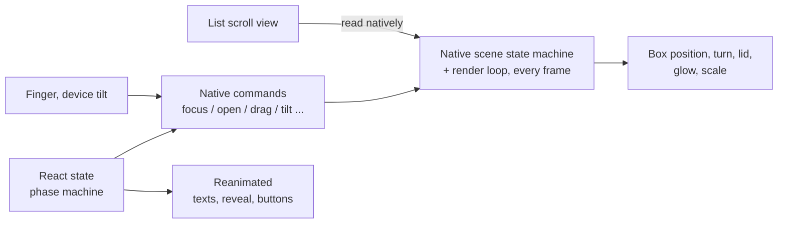

# Animations

Every animation in Mystery Watch: what it looks like, where it lives in the code, and how it works. All screenshots are real, taken from this app (release builds): iOS on the iPhone 17 Simulator, Android on the MW_Pixel9_API_37 emulator.

> The numbers in the code are the single source of truth. This page quotes them, so if a value changes, change it in the file named in the "Where" column.

- [1. The big picture](#1-the-big-picture)
- [2. Catalogue](#2-catalogue)
- [3. Inspecting a box](#3-inspecting-a-box)
- [4. Buying and opening](#4-buying-and-opening)
- [5. The reveal, by rarity](#5-the-reveal-by-rarity)
- [6. Collection](#6-collection)
- [7. Light, shadow and shine](#7-light-shadow-and-shine)
- [8. Sound and haptics](#8-sound-and-haptics)
- [9. Why it stays smooth](#9-why-it-stays-smooth)
- [10. Honest limits](#10-honest-limits)

---

## 1. The big picture

There are two kinds of animation, and they run in two different places:

| Kind | Runs in | Used for | Technology |
|---|---|---|---|
| **3D scene** | The native render loop (Swift / Kotlin, once per frame, no JavaScript) | Boxes, lids, light, camera push-in, drag, auto-turn | `modules/mystery-scene`: SceneKit (iOS), Filament (Android) |
| **2D interface** | The Reanimated UI runtime | Texts, buttons, the reveal (pill, glow, watch image, particles), lists, tabs | `react-native-reanimated` |

The 3D scene never waits for JavaScript. JavaScript sends one small command per event (select, open, drag move, tilt reading); the native scene keeps the state, reads the list's scroll position itself, and moves the boxes every frame. See [NATIVE_SCENE.md](NATIVE_SCENE.md).

One whole purchase, as a timeline:

```mermaid
gantt
  dateFormat X
  axisFormat %Ls
  section Inspect
  Box flies to the middle (500 ms) :a1, 0, 500
  Slow auto-turn starts after 1.5 s idle :a2, 1500, 2500
  section Open
  Anticipation shake and swell (800 ms) :b1, 3000, 800
  Lid swings open (1100 ms) :b2, 3800, 1100
  section Reveal
  Pill, glow, watch flip, price :c1, 4900, 900
  Box waits, then is put away (700 ms) :c2, 6700, 700
```

---

## 2. Catalogue

### Boxes pop in one after another

  

On the first appearance the boxes grow from nothing with a small overshoot, 90 ms apart, while their card texts fade in from below with the same rhythm.

- **Where:** the box: `math/Poses.kt` (`computeEntranceScale`) and `ios/SceneCore/Sources/SceneCore/CardAnimation.swift`; the texts: `BoxCard.tsx` (`FadeInDown`); values in `SceneConfig` (`ENTRANCE_DURATION_MILLISECONDS` 520, `ENTRANCE_STAGGER_MILLISECONDS` 90), mirrored from `catalogueLayoutConfig.ts`.
- **How:** the native scene remembers when the model finished loading. Each box computes its own scale from "now minus start minus index times the stagger". No timers, no state in JavaScript.

### Boxes follow the scroll

While the list scrolls, every box sits exactly in its card's transparent slot and turns a little (parallax). Neighbours have slightly different signature angles that repeat every three cards, so the list never looks like copies.

- **Where:** `computeBoxPose` in `BoxPose.swift` / `Poses.kt`.
- **How:** pure maths from the scroll offset (unit-tested against the TypeScript reference). The scene reads the list's native scroll position itself. Boxes far outside the screen are hidden.

### Press squeeze

Pressing a card squeezes its box to 92 % in 140 ms and lets it spring back on release. If the finger slides away, the box bounces back without opening.

- **Where:** `CardAnimation.swift` / `Poses.kt` (`computePressScale`), `useCatalogueFacade.ts` (`handleCardPressIn/Out` → `MysteryScene.pressIn/pressOut`).

### Animated balance

Numbers count to their new value instead of jumping (balance in the header, total value in the collection).

- **Where:** `services/animation/useAnimatedNumber.ts` and `computeAnimatedNumber.ts`.

### Tabs fade

Switching between Boxes and Collection cross-fades. The inactive screen stays mounted (`detachInactiveScreens={false}`), so the 3D scene is never torn down.

- **Where:** `navigation/navigators/TabNavigator/TabNavigator.tsx` (`animation: 'fade'`).

---

## 3. Inspecting a box

### Camera push-in (dolly)

 

Tapping a card sends its box to the middle in 500 ms. It also moves towards the camera with a small overshoot (0.9 units), so perspective makes it swell like a push-in. All other boxes shrink away.

- **Where:** `OpeningPose.swift` / `Poses.kt` (`computeOpeningPose`), `OpeningState`, `Easing`. Values: `SceneConfig` (mirrors `openingConfig.ts`).

While a box is inspected the **Back** button sits in the top left corner and the box name and price are centred on the screen below it, in line with the button at the bottom.

### Gestures on the focused box

| Gesture | What happens | Values |
|---|---|---|
| Drag | The box turns under the finger; after a flick it keeps turning and slows down (inertia) | 0.012 rad per pixel, velocity x 0.94 every frame |
| Pinch | Zoom | 0.7x to 2x |
| Double tap | Turn and zoom glide back to the start | 0.05 % of the distance left after 1 s |
| Idle for 1.5 s | The box turns slowly by itself, easing in over 1 s | 0.4 rad per second |
| Device tilt | The box leans a little with the phone (gyroscope) | up to 0.22 rad sideways, 0.14 rad up and down |
| Swipe up (after buying) | Opens the box, same as the button | 90 px |

- **Where:** `useOpeningFacade.ts` (gestures with `react-native-gesture-handler`, forwarded as `dragBy` / `dragEnd` / `pinch` / `resetView`), `DragInertia.swift` / `DragInertia.kt` (inertia, auto-turn, reset), `useFacadeDeviceTilt.ts` (`expo-sensors` → `setTilt`).
- **How:** the drag state lives in the native scene. The gesture sends finger movements; inertia, auto-turn and the glide back run natively. While anything is still moving the loop runs; when everything has stopped, it sleeps (see section 9).

---

## 4. Buying and opening

### Anticipation, lid, inner light

| Anticipation (800 ms) | Lid opens, light from inside (1100 ms) |
|---|---|
|  |  |

1. **Anticipation.** The box eases back to its base pose, then shakes harder and harder and swells by 10 % for 800 ms. A rumbling sound and a haptic buzz go with it.
2. **Lid.** It swings open about its real hinge with a small overshoot (`easeOutBack`), 1100 ms.
3. **Inner light.** While the lid opens, the cushion and the inside of the lid glow in the colour of the prize and then pulse softly (1.6 s period).

- **Where:** `OpeningState` (`computeAnticipationEffect`, `computeGlowStrength`), `LidHinge`; the engine side: `BoxScene.swift` (`setLid`, `setGlow`) and `FilamentBoxScene.kt`.
- **How:** the lid is a separate part of the model. Each frame it is rotated about the hinge pivot with a matrix. The glow is the material's emission (`emissiveFactor` in Filament, `emission` in SceneKit), so the bloom picks it up.

A swipe up opens the box the same way. Whatever angle the box was turned to, it glides back to the base pose first, so an opened box always reads the same.

---

## 5. The reveal, by rarity

The prize is revealed on a clean stage. From the top: a **rarity pill**, the **watch** in two big pulsing circles, the **price** as the hero, then name and brand. The better the watch, the bigger the show:

| | Common | Rare | Epic | Legendary |
|---|---|---|---|---|
| Worth | under $500 | under $1,000 | under $2,000 | $2,000 and more |
| Colour | grey-blue | blue | purple | gold |
| Particles | none | 10 | 18 | 28 |
| White flash | none | none | 55 % | 90 % |
| Extra haptic taps | 0 | 1 | 2 | 3 |
| Sound | short chime | rising triad | rising triad (same as Rare) | full fanfare |

| Common | Rare (current layout, no tab bar) | Legendary |
|---|---|---|
|  |  |  |

The Common and Legendary pictures were taken before the tab bar was hidden during a reveal; everything else on them is current.

What happens, in order:

1. The **flash** and the **particles** burst out (under the watch, never over it).
2. The **watch** rises out of the box and flips like a coin (a flat `scaleX` flip with a spring, so it settles with a small bounce).
3. The two **circles** behind the watch pulse softly and without end (inner 22 to 42 % opacity, outer 10 to 20 %).
4. The **price, name and brand** fade in from below after 450 ms.
5. After 1.8 s the **opened box is put away**: it shrinks to nothing and sinks a little in 700 ms. Only then does the **Done** button appear, centred at the bottom, so the prize is alone on the screen. While a prize is shown the bottom tab bar (Boxes / Collection) is invisible and cannot be tapped; its place is kept so the 3D scene does not move. Done brings the tab bar back and flies the box home.

| Still open, just revealed | Put away |
|---|---|
|  |  |

- **Where:** the tab bar is hidden through the `isTabBarHidden` route parameter set by `useCatalogueFacade` and read in `TabNavigator.tsx`. Also: `openingFlow/screens/OpeningOverlay/` (`OpeningOverlay.tsx` and the `RevealEffects`, `WatchRevealImage`, `Particle` parts, each with its hook in `_facades/`), `openingFlow/_config/rarityConfig.ts` (the table above), `getWatchRarity.ts`, `computeParticleTrajectory.ts`, `computeOpeningPose.ts` (`tuckProgress`), `openingSceneState.ts` (`startTuck`).
- **Two design decisions worth knowing:**
  - The watch flips **flat**, not in 3D. A 3D-turned layer slides behind the glow circles for a moment, and half of the watch looked washed out.
  - The flash and the particles are drawn **under** the watch and its texts, so nothing ever covers the watch.

---

## 6. Collection

| Fade in, rows slide up | Detail sheet |
|---|---|
|  |  |

- Rows slide up one after another (`FadeInDown`, 400 ms). Each row shows the rarity in its colour.
- Tapping a row opens a detail sheet with the large photo and a border in the rarity colour.
- The total value counts up whenever a watch is added.
- **Where:** `collectionFlow/screens/CollectionScreen/` (`WatchListItem`, `CollectionDetailModal`), `useCollectionFacade.ts`.

---

## 7. Light, shadow and shine

The same rig on both platforms (numbers mirrored from the first version; the engines express them in different units):

- **Three lights plus reflections.** A warm key light from the upper left (casts shadows), a cool rim light from behind that outlines the box against the dark background, and a soft fill from below. An environment gives glossy and metallic boxes something to reflect (a Filament KTX image on Android, a generated studio image on iOS).
- **Shadows.** The lid shades the inside of the box and the box shades its own lower edge.
- **Ambient occlusion.** Corners and creases get softly darker.
- **Bloom.** The inner light and bright highlights bleed softly into the picture.
- **Finish by price.** The dearer the box, the more it shines (computed in TypeScript by `getBoxFinish` and sent to the scene as the cards' look):

| Box price | Finish | Roughness | Metallic | Clear coat |
|---|---|---|---|---|
| under $100 | matte | 0.85 | 0 | 0 |
| under $300 | satin | 0.55 | 0.1 | 0.2 |
| under $700 | glossy | 0.30 | 0.3 | 0.7 |
| $700 and more | metal | 0.18 | 0.65 | 1 |

- **Where:** `getBoxFinish.ts`; `BoxScene.swift` (`configureCamera`, `configureLights`, `setCards`), `FilamentBoxScene.kt` (`configureView`, `configureLights`, `setCards`).

---

## 8. Sound and haptics

Every sound is synthesised by a script (`yarn assetsSounds`, `scripts/assets/generateSounds.py`): no downloads, no licences, each file well under 100 KB.

| Moment | Sound | Haptic |
|---|---|---|
| Box selected | soft tick | selection tick |
| Purchase | two rising blips | success |
| Anticipation | rising rumble | light impact |
| Lid opens | click and falling thump | heavy impact |
| Reveal | chime, triad or fanfare by rarity | success, then 0 to 3 heavy impacts 140 ms apart |
| Error | falling buzz | error |

- **Where:** `services/sounds/soundEffects.ts` (`expo-audio`), `services/haptics/hapticFeedback.ts` (`expo-haptics`).
- Sounds play even with the silent switch on and mix with other audio. Each effect has two players used in turn, so opening boxes quickly one after another never cuts a sound off. A device without audio never breaks the app.

---

## 9. Why it stays smooth

- **Render on demand.** The scene draws frames only while its state machine says something moves (scroll, press, inspect, opening, reveal) and stops after three idle frames (`needsFrames`). Any command or scroll wakes it.
- **One scene.** All boxes live in one native scene and are placed with one matrix each per frame.
- **No JavaScript in the frame loop.** The loop reads the native state machine; the scroll position is read natively.
- **Measured:** the catalogue scrolls at **60.0 FPS with 0 slow frames** (51 one-second windows, worst frame 17 ms) on the iPhone 17 Simulator with all of the lighting above switched on. Details and the method are in [PERFORMANCE.md](PERFORMANCE.md).

---

## 10. Honest limits

- The pictures are screenshots, not videos. Animations are best judged on the device.
- All screenshots here are from iOS (simulator). Android runs the same code and the same render settings, but its look was not re-checked after the final polish of the reveal.
- Sounds and device tilt are covered by unit tests and run on the device, but they cannot be heard or felt in a screenshot, and tilt cannot be tested in the simulator.
- The opening flow was not measured separately for FPS; the catalogue scroll was.
