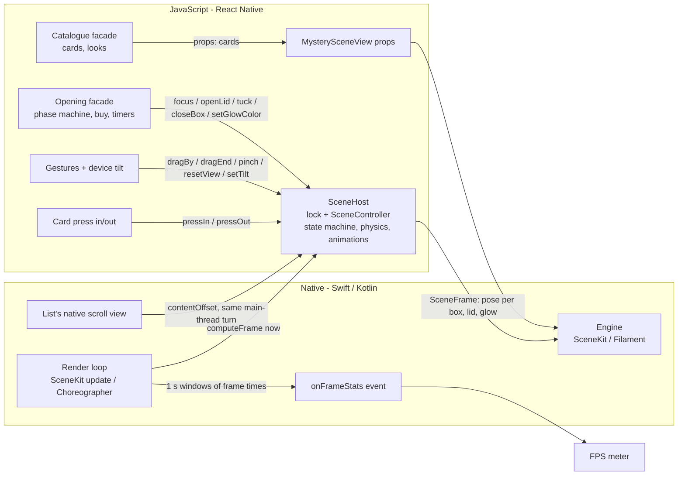

# The native 3D scene

The 3D of Mystery Watch is **one native view**, `MysteryScene`, written in Swift (iOS) and Kotlin (Android) with the Expo Modules API. It lives in `modules/mystery-scene` and is autolinked by `expo prebuild`. There is no JavaScript 3D library anywhere: the native code loads the model, owns the frame loop and does all 3D work.

- [1. Layout of the module](#1-layout-of-the-module)
- [2. Data flow JavaScript ↔ native](#2-data-flow-javascript--native)
- [3. The JavaScript API](#3-the-javascript-api)
- [4. Scroll sync](#4-scroll-sync)
- [5. Engines and why](#5-engines-and-why)
- [6. Render on demand](#6-render-on-demand)
- [7. Parity with the TypeScript reference](#7-parity-with-the-typescript-reference)
- [8. Where the look differs between the platforms](#8-where-the-look-differs-between-the-platforms)

---

## 1. Layout of the module

```
modules/mystery-scene/
  expo-module.config.json          autolinking: MysterySceneModule (apple) / expo.modules.mysteryscene.MysterySceneModule (android)
  assets/box.glb                   the supplied model (uncompressed original, 1.3 MB), one copy for both platforms
  assets/env_ibl.ktx               image based light of the Android scene (Filament KTX)
  src/                             the typed JavaScript API (view + synchronous commands)
  test-vectors/sceneVectors.json   expected numbers generated by the TypeScript reference
  ios/
    MysteryScene.podspec
    MysterySceneModule.swift       JS API
    MysterySceneView.swift         ExpoView: SCNView, render loop, scroll KVO, frame timing
    BoxScene.swift                 SceneKit scene: camera, lights, environment, box instances, applies a SceneFrame
    GlbLoader.swift                glTF 2.0 binary reader that builds SceneKit geometry (SceneKit cannot read glTF)
    SceneHost.swift                the one controller + its lock
    SceneCore/                     Swift package: pure maths and state machine (no UIKit/SceneKit), `swift test`
  android/
    build.gradle                   Filament dependencies
    src/main/java/expo/modules/mysteryscene/
      MysterySceneModule.kt, MysterySceneView.kt (TextureView + Choreographer), FilamentBoxScene.kt, SceneHost.kt
      math/                        the same pure maths and state machine in Kotlin
    src/test/                      JUnit: parity + behaviour
```

`SceneCore` (Swift) and `math/` (Kotlin) are the same code in two languages, file for file: `SceneConfig`, `Easing`, `BoxPose`/`Poses`, `OpeningState`, `DragInertia`, `CardAnimation`, `OpeningPose`, `LidHinge`, `SceneController`.

## 2. Data flow JavaScript ↔ native



- **JS to native, per frame: nothing.** The list's scroll position is read by the native side itself (section 4). Fingers and sensors send a small command only when they change something (`dragBy` per finger move, `setTilt` ~30 Hz while a box is open). Everything that is time based (focus fly-in, lid, anticipation shake, glow pulse, tuck, entrance, press squeeze, inertia, auto-turn) is a function of "now" inside the native state machine, so JavaScript sends **one command per event**, not per frame.
- **Commands are synchronous native calls** (`Function` in the Expo Modules API, JSI). They take the controller's lock, write the new state and wake the render loop. No view update, no Fabric commit, no main-thread hop.
- **Native to JS:** only events: `onModelLoaded`, `onSceneError`, `onScrollSourceChange` and, in measurement builds, `onFrameStats` once per second.
- JavaScript still owns **everything that is not 3D**: the flows, the phase machine (`openingPhaseMachine`), the purchase with its exactly-once guarantee, the mock API, sounds, haptics, overlays (pill, hero price, circles, flash, particles), tabs, collection. The timers of an opening (sound at the lid, the reveal, "put the box away") stay in JavaScript, as before; the native scene runs its own timeline from the same moment (one `openLid()` call).

## 3. The JavaScript API

`import { MysteryScene, MysterySceneView } from '@mysteryScene'` (types in `modules/mystery-scene/src/MysteryScene.types.ts`).

**View props**

| Prop | Meaning |
|---|---|
| `cards` | One `{ color (linear RGB), roughness, metallic, clearCoat }` per box. The scene creates that many instances of the model and gives the body of each its colour and finish (the per-price finish is computed in TypeScript by `getBoxFinish`). |
| `scrollViewTag` | React tag of the list's native scroll view; the scene then reads the scroll offset itself. `null`: JavaScript feeds it. |
| `isFrameStatsEnabled` | Emit `onFrameStats` (measurement builds). |
| `onModelLoaded`, `onSceneError`, `onScrollSourceChange`, `onFrameStats` | Events. |

**Commands** (`MysteryScene.*`, synchronous)

`setScrollOffset(y)` · `pressIn(index)` / `pressOut()` · `focus(index)` · `closeBox()` · `openLid()` · `setGlowColor(r, g, b)` · `tuck()` · `dragBy(dx, dy)` · `dragEnd(vx, vy)` · `pinch(factor)` · `resetView()` · `setTilt(x, y)`.

The view needs no viewport prop: it measures itself (density independent pixels, the same unit as the list styles) and places every box in its card slot from `catalogueLayoutConfig` numbers.

## 4. Scroll sync

The boxes must sit exactly in their cards while the list moves. Three ways were considered:

| Way | Cost | Result |
|---|---|---|
| Scroll event → JS thread → `setScrollOffset` (sync JSI call) | one JS-thread hop per event, 0–1 frame of lag | works; kept as a **fallback** (`EXPO_PUBLIC_SCROLL_SOURCE=bridge`, or when the scroll view cannot be found) |
| Scroll event → Fabric prop → native | a shadow-tree commit per frame | rejected: heavier than the call above |
| **The scene observes the native scroll view itself** | none: iOS KVO on `UIScrollView.contentOffset`, Android `ScrollView` scroll listener; both run on the main thread in the turn in which the list moves | **default** |

The facade passes the scroll view's React tag (`FlashList.getScrollableNode()`) once the list exists; the native view looks the view up, attaches, and reports `onScrollSourceChange({source: 'native'})`. If the lookup fails it reports `'bridge'` and JavaScript takes over. Measurements: see [PERFORMANCE.md](PERFORMANCE.md#scroll-sync).

## 5. Engines and why

| | iOS | Android |
|---|---|---|
| Engine | **SceneKit** (Metal) | **Google Filament on its Vulkan backend** (OpenGL ES fallback) used directly: `filament-android`, `gltfio-android`, `filament-utils-android` |
| Model | own GLB reader (`GlbLoader.swift`) builds `SCNGeometry` + PBR `SCNMaterial` | gltfio `AssetLoader` (instanced asset) |
| View | `SCNView` | `TextureView` (keeps alpha / fade animations of the screen working) |
| Loop | `SCNSceneRendererDelegate.updateAtTime`, `isPlaying` toggled | `Choreographer` frame callback, posted only while needed |
| Post effects | HDR + bloom, SSAO, 4x MSAA, deferred shadows | FXAA, bloom, SSAO, shadows (same settings as the previous version) |

Why these:

- **iOS: SceneKit.** It gives PBR materials (roughness, metalness, clear coat, emission), image based light, deferred shadows, SSAO and bloom with no extra code, and it renders on Metal. The alternatives: *RealityKit* loads only USDZ (the GLB would need a build-time conversion tool that is not on a clean machine), and its per-frame control and post effects are far more limited; *raw Metal* would mean writing PBR, shadows, SSAO and bloom by hand. The price: SceneKit cannot read glTF, so `GlbLoader.swift` (about 250 lines) reads exactly what the model needs. SceneKit is in maintenance mode at Apple (new work goes to RealityKit); for a proof of concept that is acceptable, and the engine-facing part is isolated in `BoxScene.swift` so it could be swapped.
- **Android: Filament directly.** The model's materials (PBR + clear coat) are exactly what Filament's glTF loader (gltfio) supports; instancing, per-instance material parameters and bloom/SSAO/shadows are built in. SceneView (the Jetpack Compose wrapper) was not chosen: this is a View hierarchy, not Compose, and the wrapper adds a lifecycle layer without adding capability. Filament is the same engine the previous (JavaScript-driven) version used, which keeps the look close.
- Using one engine on both platforms (Filament on iOS too) was possible but means shipping and linking ~90 MB of C++ static libraries and Swift/C++ interop for a small scene; the two native engines are lighter and idiomatic.

## 6. Render on demand

The GPU rests when nothing moves (battery). The `SceneController` answers `needsFrames(now)`:

- true while: the entrance runs, a card is pressed, the box flies in or home, the lid moves, the box is put away, a drag/inertia/reset is in progress, a closed box is inspected (it turns by itself), or the opened box glows (until it is put away);
- true for 120 ms after any command and 300 ms after a scroll offset change (so a command always gets its frame);
- otherwise false: after three idle frames the loop stops (`isPlaying = false` / no more `postFrameCallback`). The last picture stays on screen; the next command or scroll wakes the loop.

## 7. Parity with the TypeScript reference

`src/services/sceneReference/computeSceneFrame.ts` reproduces, in TypeScript, what the old render callback computed for every frame (using the original `_facadesLogic` functions). A Jest test runs three long scenarios (entrance and scroll; press squeeze; select, auto-turn, drag, flick, pinch, reset, tilt, open, glow, tuck, close, select again) and writes/compares `test-vectors/sceneVectors.json`: every 4th frame of every scenario with all poses, lid angle and hinge transform, glow. The XCTest suite and the JUnit suite replay the same commands through the native `SceneController` and compare every number to 1e-9. Result: both pass (see [TESTING.md](TESTING.md)).

What this proves: the native ports compute the same box poses, lid angles and glow as the TypeScript. What it does not prove: that the engine draws them the same way, which is a visual check (screenshots in [ANIMATIONS.md](ANIMATIONS.md)).

## 8. Where the look differs between the platforms

See [ANIMATIONS.md, "Platform differences"](ANIMATIONS.md#platform-differences).
